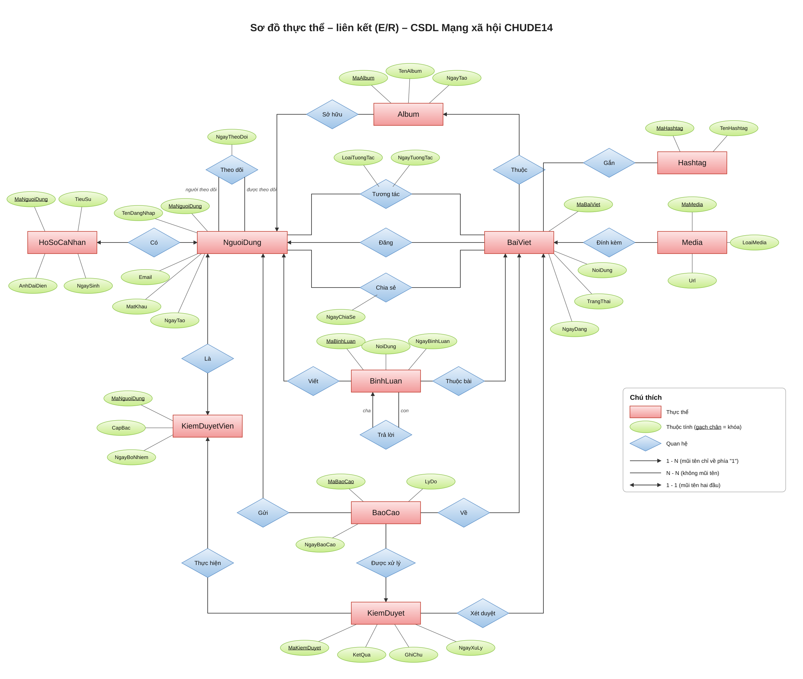
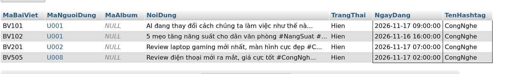
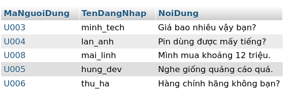
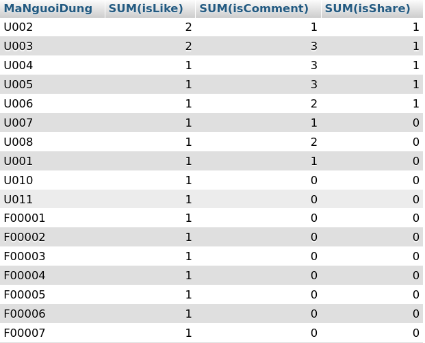
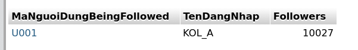
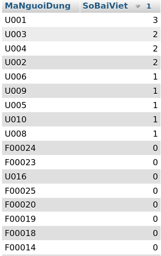
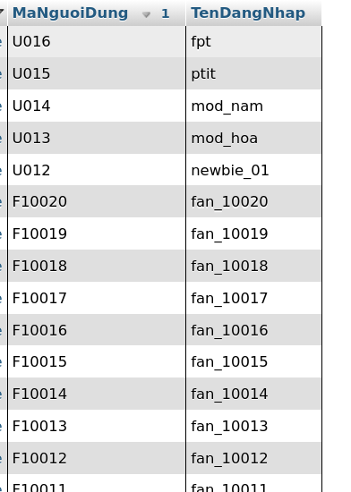
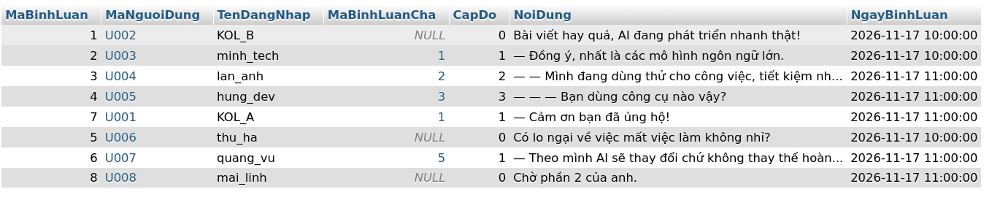
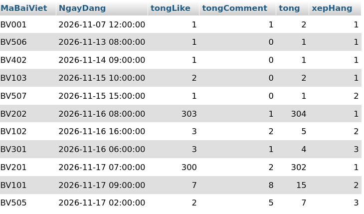

## Mục lục

- [1. Phân tích Yêu cầu](#1-phân-tích-yêu-cầu)
- [2. Thiết kế Cơ sở dữ liệu](#2-thiết-kế-cơ-sở-dữ-liệu)
- [3. Mô hình Thực thể Kết hợp (ER Model \& Quan hệ giữa các bảng)](#3-mô-hình-thực-thể-kết-hợp-er-model--quan-hệ-giữa-các-bảng)
- [4. Sơ đồ thực thể](#4-sơ-đồ-thực-thể)
- [5. Truy vấn](#5-truy-vấn)
    - [1. Cơ bản: Danh sách bài viết được đăng trong 24 giờ qua có chứa Hashtag #CongNghe.](#1-cơ-bản-danh-sách-bài-viết-được-đăng-trong-24-giờ-qua-có-chứa-hashtag-congnghe)
    - [2. Inner Join: Hiển thị danh sách những người dùng đã bình luận vào bài viết BV505 kèm nội dung bình luận.](#2-inner-join-hiển-thị-danh-sách-những-người-dùng-đã-bình-luận-vào-bài-viết-bv505-kèm-nội-dung-bình-luận)
    - [3. Group By: Thống kê tổng số lượt tương tác (Like + Comment + Share) của từng người dùng trong tuần.](#3-group-by-thống-kê-tổng-số-lượt-tương-tác-like--comment--share-của-từng-người-dùng-trong-tuần)
    - [4. Having: Tìm những người dùng có số lượng follower \> 10.000 nhưng có tỷ lệ tương tác trung bình trên mỗi bài viết \< 0.5%.](#4-having-tìm-những-người-dùng-có-số-lượng-follower--10000-nhưng-có-tỷ-lệ-tương-tác-trung-bình-trên-mỗi-bài-viết--05)
    - [5. Outer Join: Liệt kê tất cả người dùng và số bài viết họ đã đăng (bao gồm cả người dùng chưa từng đăng bài).](#5-outer-join-liệt-kê-tất-cả-người-dùng-và-số-bài-viết-họ-đã-đăng-bao-gồm-cả-người-dùng-chưa-từng-đăng-bài)
    - [6. Subquery với NOT EXISTS: Tìm những người dùng chưa từng tương tác (Like/Comment) với bất kỳ bài viết nào của người dùng "KOL\_A".](#6-subquery-với-not-exists-tìm-những-người-dùng-chưa-từng-tương-tác-likecomment-với-bất-kỳ-bài-viết-nào-của-người-dùng-kol_a)
    - [7. Recursive CTE: Truy vấn toàn bộ luồng bình luận (Comment tree - bao gồm các reply cấp 1, cấp 2, cấp 3) của bài viết BV101.](#7-recursive-cte-truy-vấn-toàn-bộ-luồng-bình-luận-comment-tree---bao-gồm-các-reply-cấp-1-cấp-2-cấp-3-của-bài-viết-bv101)
    - [8. Window Functions: Xếp hạng top 3 bài viết có lượng tương tác cao nhất mỗi ngày bằng ROW\_NUMBER() OVER(PARTITION BY NgayDang ORDER BY TongTuongTac DESC).](#8-window-functions-xếp-hạng-top-3-bài-viết-có-lượng-tương-tác-cao-nhất-mỗi-ngày-bằng-row_number-overpartition-by-ngaydang-order-by-tongtuongtac-desc)
# 1. Phân tích Yêu cầu
Nghiệp vụ thực tế:

+ Quản lý tài khoản & Hồ sơ: Quản lý thông tin đăng nhập của người dùng (tên đăng nhập, email, mật khẩu, ngày tạo) và hồ sơ cá nhân tương ứng (tiểu sử, ảnh đại diện, ngày sinh).

+ Phân quyền kiểm duyệt: Một số người dùng được bổ nhiệm làm Kiểm duyệt viên (có cấp bậc và ngày bổ nhiệm) để duyệt bài viết và xử lý các báo cáo vi phạm.

+ Mối quan hệ xã hội: Quản lý quan hệ theo dõi (Follower/Following) giữa các người dùng với nhau, có ghi nhận ngày bắt đầu theo dõi.

+ Nội dung số: Người dùng viết Bài viết, đính kèm nhiều tệp Media (ảnh/video) vào mỗi bài viết, gom bài viết vào Album, gắn nhãn Hashtag và thực hiện Bình luận đa cấp (Parent-Child comment).

+ Tương tác: Ghi nhận các lượt tương tác (Like/Reaction) và lượt chia sẻ (Share) của người dùng trên bài viết.

+ Kiểm duyệt nội dung: Bài viết phải được kiểm duyệt viên duyệt mới được công khai. Người dùng gửi báo cáo vi phạm kèm lý do; kiểm duyệt viên ghi nhận kết quả kiểm duyệt (vi phạm / không vi phạm), mỗi lần kiểm duyệt xử lý luôn các báo cáo đang chờ của bài đó.

Quy tắc nghiệp vụ ràng buộc (Business Rules):

+ Một người dùng không được phép tự theo dõi chính mình.

+ Mỗi người dùng chỉ được phép tương tác (like/reaction) một lần duy nhất trên mỗi bài viết.

+ Mỗi người dùng chỉ được chia sẻ một bài viết một lần.

+ Mỗi người dùng chỉ được báo cáo một bài viết một lần.

+ Media đính kèm bài viết chỉ thuộc một trong hai loại: 'ANH' hoặc 'VIDEO'.

+ Bình luận trả lời phải thuộc cùng bài viết với bình luận cha.

+ Bài viết mới mặc định tạm ẩn (TamAn), chỉ hiển thị (Hien) khi kiểm duyệt viên kết luận không vi phạm; nếu vi phạm thì giữ TamAn. Kiểm duyệt viên không xóa bài, việc xóa do tác giả quyết định.

+ Chỉ được báo cáo bài viết đang hiển thị.

+ Quy tắc kiểm duyệt tự động: Bài viết đang hiển thị nhận được từ 5 báo cáo vi phạm chưa xử lý trở lên từ những người dùng khác nhau sẽ tự động chuyển sang trạng thái tạm ẩn (TamAn) để chờ kiểm duyệt viên xem xét lại.

+ Khi xóa một người dùng, toàn bộ dữ liệu của người đó (hồ sơ, album, bài viết, bình luận, tương tác, chia sẻ, báo cáo, quan hệ theo dõi) bị xóa theo. Khi xóa album, các bài viết trong album vẫn được giữ lại (chỉ gỡ khỏi album). Khi một kiểm duyệt viên bị xóa, các lần kiểm duyệt họ đã thực hiện vẫn được giữ lại.

# 2. Thiết kế Cơ sở dữ liệu
Cơ sở dữ liệu được thiết kế đạt chuẩn 3NF (Dạng chuẩn 3) nhằm hạn chế tối đa dư thừa dữ liệu và đảm bảo tính toàn vẹn. Hệ quản trị: MySQL 8.0+.
Các thành phần ràng buộc kỹ thuật:

+ Khóa chính (PRIMARY KEY):
  - Khóa đơn tự tăng INT AUTO_INCREMENT: NguoiDung, Album, BaiViet, Media, BinhLuan, TuongTac, ChiaSe, Hashtag, KiemDuyet, BaoCao.
  - Khóa chính đồng thời là khóa ngoại (quan hệ 1 - 1): HoSoCaNhan, KiemDuyetVien (MaNguoiDung).
  - Khóa chính phức hợp: TheoDoi (MaNguoiDungFollow, MaNguoiDungBeingFollowed), BaiViet_Hashtag (MaBaiViet, MaHashtag).

+ Khóa ngoại (FOREIGN KEY): Liên kết chặt chẽ giữa các bảng, kết hợp các cơ chế:
  - ON DELETE CASCADE: tự động dọn dữ liệu con khi xóa thực thể gốc (áp dụng cho hầu hết các khóa ngoại, kể cả khóa tự tham chiếu MaBinhLuanCha: xóa bình luận cha sẽ xóa toàn bộ trả lời bên dưới).
  - ON DELETE SET NULL: BaiViet.MaAlbum (xóa album thì bài viết giữ lại, MaAlbum = NULL) và KiemDuyet.MaKiemDuyetVien (xóa kiểm duyệt viên thì lịch sử kiểm duyệt giữ lại, MaKiemDuyetVien = NULL).
  - Khóa ngoại phức hợp: BinhLuan (MaBinhLuanCha, MaBaiViet) đảm bảo bình luận cha cùng bài viết; BaoCao (MaKiemDuyet, MaBaiViet) đảm bảo báo cáo chỉ gắn vào lần kiểm duyệt của đúng bài đó.

+ Ràng buộc CHECK:
  - CHK_KhongTuFollow: Đảm bảo mã người theo dõi khác với mã người được theo dõi (MaNguoiDungFollow <> MaNguoiDungBeingFollowed).
  - CHK_LoaiMedia: Loại media chỉ nhận giá trị 'ANH' hoặc 'VIDEO'.
  - CHK_TrangThaiBaiViet: Trạng thái bài viết chỉ nhận 'TamAn' (chờ duyệt / không hiển thị) hoặc 'Hien' (công khai).
  - CHK_LoaiTuongTac: Loại tương tác chỉ nhận 'LIKE', 'LOVE', 'HAHA', 'WOW', 'SAD' hoặc 'ANGRY'.
  - CHK_KetQuaKiemDuyet: Kết quả kiểm duyệt chỉ nhận 'ViPham' hoặc 'KhongViPham'.

+ Ràng buộc UNIQUE:
  - NguoiDung: TenDangNhap và Email là duy nhất.
  - Hashtag: TenHashtag là duy nhất.
  - TuongTac: cặp (MaNguoiDung, MaBaiViet) là duy nhất.
  - ChiaSe: cặp (MaNguoiDung, MaBaiViet) là duy nhất.
  - BaoCao: cặp (MaBaiViet, MaNguoiDungBaoCao) là duy nhất.

+ Giá trị mặc định (DEFAULT): BaiViet.TrangThai = 'TamAn', TuongTac.LoaiTuongTac = 'LIKE' (hai cột này đều NOT NULL), KiemDuyetVien.CapBac = 'KiemDuyetVien'. BaoCao.MaKiemDuyet = NULL nghĩa là báo cáo chưa được xử lý.

+ Kiểu dữ liệu thời gian: Các cột ghi nhận thời điểm (NgayTao, NgayBoNhiem, NgayTheoDoi, NgayDang, NgayBinhLuan, NgayTuongTac, NgayChiaSe, NgayBaoCao, NgayXuLy) dùng DATETIME DEFAULT CURRENT_TIMESTAMP để lưu đến giờ-phút-giây (phục vụ sắp xếp bảng tin, bình luận theo thời gian) và tự điền khi thêm bản ghi. Riêng NgaySinh giữ kiểu DATE.

+ Trigger tự động hóa:
  - TRG_ChanBaoCaoBaiKhongHien (BEFORE INSERT trên BaoCao): từ chối báo cáo nếu bài viết không ở trạng thái 'Hien'.
  - TRG_TuDongTamAnBaiViet (AFTER INSERT trên BaoCao): bài đang 'Hien' có ≥ 5 báo cáo chưa xử lý thì chuyển sang 'TamAn'.
  - TRG_XuLyKiemDuyet (AFTER INSERT trên KiemDuyet): 'KhongViPham' thì bài thành 'Hien', 'ViPham' thì giữ 'TamAn'; đồng thời đánh dấu các báo cáo đang chờ của bài là đã xử lý.

# 3. Mô hình Thực thể Kết hợp (ER Model & Quan hệ giữa các bảng)
Hệ thống gồm 14 bảng: NguoiDung, HoSoCaNhan, KiemDuyetVien, TheoDoi, Album, BaiViet, Media, BinhLuan, TuongTac, ChiaSe, Hashtag, BaiViet_Hashtag, KiemDuyet, BaoCao. Các mối quan hệ cụ thể như sau:

Quan hệ 1 - 1 (One-to-One):

- NguoiDung <-> HoSoCaNhan: Mỗi người dùng có tối đa một hồ sơ cá nhân chi tiết; mỗi hồ sơ thuộc đúng một người dùng.

- NguoiDung <-> KiemDuyetVien: Quan hệ chuyên biệt hóa (IS-A). Kiểm duyệt viên là một người dùng được bổ nhiệm thêm vai trò kiểm duyệt; mỗi người dùng có tối đa một bản ghi kiểm duyệt viên.

Quan hệ 1 - N (One-to-Many):

- Album --> NguoiDung: Một album chỉ được sở hữu bởi 1 người, một người dùng có thể tạo nhiều album.

- BaiViet --> NguoiDung: Một người dùng có thể đăng nhiều bài viết, một bài viết do đúng 1 người đăng.

- BaiViet --> Album: Một album có thể chứa nhiều bài viết; một bài viết thuộc tối đa 1 album (có thể không thuộc album nào).

- Media --> BaiViet: Một bài viết có thể đính kèm nhiều ảnh/video; mỗi media thuộc đúng 1 bài viết.

- BinhLuan --> BaiViet: Một bài viết có nhiều bình luận; mỗi bình luận thuộc đúng 1 bài viết.

- BinhLuan --> NguoiDung: Một người dùng có thể viết nhiều bình luận; mỗi bình luận do đúng 1 người viết.

- BaoCao --> NguoiDung: Một người dùng có thể gửi nhiều báo cáo; mỗi báo cáo do đúng 1 người gửi.

- BaoCao --> BaiViet: Một bài viết có thể nhận nhiều báo cáo; mỗi báo cáo nhắm vào đúng 1 bài viết.

- BaoCao --> KiemDuyet: Một lần kiểm duyệt xử lý nhiều báo cáo; mỗi báo cáo được xử lý trong tối đa 1 lần kiểm duyệt (NULL khi chưa xử lý).

- KiemDuyet --> BaiViet: Một bài viết có thể được kiểm duyệt nhiều lần; mỗi lần kiểm duyệt xét đúng 1 bài viết.

- KiemDuyet --> KiemDuyetVien: Một kiểm duyệt viên thực hiện nhiều lần kiểm duyệt; mỗi lần do 1 kiểm duyệt viên thực hiện.

Quan hệ Tự tham chiếu / Đệ quy (Self-Referencing):

- BinhLuan - BinhLuan | BinhLuan <-- BinhLuanCha: Quản lý bình luận đa cấp thông qua cột MaBinhLuanCha (bình luận gốc có NULL, các trả lời cấp con sẽ trỏ về khóa chính của bình luận cha thuộc cùng bài viết).

Quan hệ N - N (Many-to-Many):

- NguoiDung --- NguoiDung (thông qua bảng trung gian TheoDoi): Quản lý danh sách người theo dõi và được theo dõi, kèm ngày theo dõi.

- NguoiDung --- BaiViet (thông qua bảng trung gian TuongTac): Một người dùng tương tác nhiều bài viết, một bài viết có nhiều lượt tương tác; mỗi cặp chỉ có 1 lượt (kèm loại tương tác và ngày).

- NguoiDung --- BaiViet (thông qua bảng trung gian ChiaSe): Một người dùng chia sẻ nhiều bài viết, một bài viết được nhiều người chia sẻ; mỗi cặp chỉ có 1 lượt chia sẻ.

- BaiViet --- Hashtag (thông qua bảng trung gian BaiViet_Hashtag): Một bài viết có nhiều hashtag và một hashtag xuất hiện ở nhiều bài viết.


# 4. Sơ đồ thực thể 


# 5. Truy vấn

### 1. Cơ bản: Danh sách bài viết được đăng trong 24 giờ qua có chứa Hashtag \#CongNghe.
```sql
SELECT BV.MaBaiViet, BV.MaNguoiDung, BV.MaAlbum, BV.NoiDung, BV.TrangThai, BV.NgayDang, H.TenHashtag from BaiViet BV
JOIN BaiViet_Hashtag BVH ON BV.MaBaiViet = BVH.MaBaiViet
JOIN  Hashtag H ON H.MaHashtag = BVH.MaHashtag
WHERE H.TenHashtag = 'CongNghe'
AND BV.NgayDang >= DATE_SUB(CURRENT_TIMESTAMP(), INTERVAL 24 HOUR);
```



### 2. Inner Join: Hiển thị danh sách những người dùng đã bình luận vào bài viết BV505 kèm nội dung bình luận.
```sql
SELECT ND.MaNguoiDung, ND.TenDangNhap, BL.NoiDung FROM NguoiDung ND
JOIN BinhLuan BL ON BL.MaNguoiDung = ND.MaNguoiDung
WHERE BL.MaBaiViet = 'BV505';
```




### 3. Group By: Thống kê tổng số lượt tương tác (Like + Comment + Share) của từng người dùng trong tuần.
```sql
SELECT ND.MaNguoiDung, SUM(isLike), SUM(isComment), SUM(isShare)
FROM NguoiDung ND
JOIN (
	SELECT MaNguoiDung , 1 AS isLike, 0 AS isComment, 0 AS isShare
  FROM TuongTac
  WHERE NgayTuongTac >= DATE_SUB(CURRENT_DATE(), INTERVAL 7 DAY)
  
  UNION ALL
  
  SELECT MaNguoiDung , 0, 1, 0
  FROM BinhLuan
  WHERE NgayBinhLuan >= DATE_SUB(CURRENT_DATE(), INTERVAL 7 DAY)
  
  UNION ALL
  
  SELECT MaNguoiDung , 0, 0, 1
  FROM Chiase
  WHERE NgayChiaSe >= DATE_SUB(CURRENT_DATE(), INTERVAL 7 DAY)
  ) tmp
ON tmp.MaNguoiDung = ND.MaNguoiDung
GROUP BY MaNguoiDung;
```



### 4. Having: Tìm những người dùng có số lượng follower > 10.000 nhưng có tỷ lệ tương tác trung bình trên mỗi bài viết < 0.5\%.
```sql
WITH 
tmp1 AS(
    SELECT TuongTac.MaBaiViet AS MBV, COUNT(*) AS LikePerPost
    FROM TuongTac 
    GROUP BY TuongTac.MaBaiViet
),
tmp2 as(
    SELECT ND.MaNguoiDung as MND, AVG(LikePerPost) AS AVGLikePerPost
    FROM tmp1
    JOIN BaiViet BV ON tmp1.MBV = BV.MaBaiViet
    JOIN NguoiDung ND ON ND.MaNguoiDung = BV.MaNguoiDung
    GROUP BY ND.MaNguoiDung
)
SELECT MaNguoiDungBeingFollowed, ND.TenDangNhap, COUNT(*) AS Follower, tmp2.AVGLikePerPost from TheoDoi 
JOIN NguoiDung ND ON ND.MaNguoiDung = TheoDoi.MaNguoiDungBeingFollowed
JOIN tmp2 on MaNguoiDungBeingFollowed = tmp2.MND
GROUP BY MaNguoiDungBeingFollowed, tmp2.AVGLikePerPost
HAVING Followers >= 10000
and tmp2.AVGLikePerPost < 0.5/100 * Followers;
```



### 5. Outer Join: Liệt kê tất cả người dùng và số bài viết họ đã đăng (bao gồm cả người dùng chưa từng đăng bài).
```sql
select ND.MaNguoiDung, count(BV.MaBaiViet) as SoBaiViet
from NguoiDung ND
left join BaiViet BV on BV.MaNguoiDung = ND.MaNguoiDung
group by ND.MaNguoiDung;
```

### 6. Subquery với NOT EXISTS: Tìm những người dùng chưa từng tương tác (Like/Comment) với bất kỳ bài viết nào của người dùng "KOL_A".

```sql
SELECT
    ND.MaNguoiDung,
    ND.TenDangNhap
FROM NguoiDung ND
WHERE NOT EXISTS (
    SELECT 1
    FROM TuongTac  TT
    JOIN BaiViet AS BV ON BV.MaBaiViet = BV.MaBaiViet
    JOIN NguoiDung AS tacGia ON tacGia.MaNguoiDung = BV.MaNguoiDung
    WHERE TT.MaNguoiDung = ND.MaNguoiDung
    AND tacGia.TenDangNhap = 'KOL_A'
)
AND NOT EXISTS (
    SELECT 1
    FROM BinhLuan AS BL
    JOIN BaiViet AS BV ON BV.MaBaiViet = BL.MaBaiViet
    INNER JOIN NguoiDung AS tacGia ON tacGia.MaNguoiDung = BV.MaNguoiDung
    WHERE BL.MaNguoiDung = ND.MaNguoiDung
    AND tacGia.TenDangNhap = 'KOL_A'
);
```

### 7. Recursive CTE: Truy vấn toàn bộ luồng bình luận (Comment tree - bao gồm các reply cấp 1, cấp 2, cấp 3) của bài viết BV101.
```sql
WITH RECURSIVE TREE AS (
    Select
        BL.MaBaiViet,
        BL.MaNguoiDung,
        BL.MaBinhLuan,
        BL.MaBinhLuanCha,
        BL.NoiDung,
        BL.NgayBinhLuan,
        0 AS CapDo,
        CAST(BL.MaBinhLuan AS CHAR(100)) AS DuongDan
    FROM BinhLuan AS BL
    WHERE BL.MaBaiViet = 'BV101'
    AND BL.MaBinhLuanCha IS NULL

    UNION ALL

    SELECT
        BL.MaBaiViet,
        BL.MaNguoiDung,
        BL.MaBinhLuan,
        BL.MaBinhLuanCha,
        BL.NoiDung,
        BL.NgayBinhLuan,
        TREE.CapDo + 1,
        CONCAT(TREE.DuongDan, '/', BL.MaBinhLuan)
    FROM BinhLuan AS BL
    JOIN TREE 
    ON BL.MaBinhLuanCha = TREE.MaBinhLuan
)
SELECT
    TREE.MaBinhLuan,
    TREE.MaNguoiDung,
    ND.TenDangNhap,
    TREE.MaBinhLuanCha,
    TREE.CapDo,
    CONCAT(REPEAT('— ', TREE.CapDo), TREE.NoiDung) AS NoiDung,
    TREE.NgayBinhLuan
FROM TREE
JOIN NguoiDung AS ND
ON ND.MaNguoiDung = TREE.MaNguoiDung
ORDER BY TREE.DuongDan;
```


### 8. Window Functions: Xếp hạng top 3 bài viết có lượng tương tác cao nhất mỗi ngày bằng ROW_NUMBER() OVER(PARTITION BY NgayDang ORDER BY TongTuongTac DESC).
```sql
WITH ThongKeBaiViet AS (
    SELECT 
        bv.MaBaiViet, 
        bv.NgayDang, 
        SUM(tmp.isLike) AS tongLike, 
        SUM(tmp.isComment) AS tongComment, 
        (SUM(tmp.isLike) + SUM(tmp.isComment)) AS tong,
        ROW_NUMBER() OVER (
            PARTITION BY DATE(bv.NgayDang) 
            ORDER BY (SUM(tmp.isLike) + SUM(tmp.isComment)) DESC
        ) AS xepHang
    FROM BaiViet bv
    JOIN (
        SELECT tt.MaBaiViet, 1 AS isLike, 0 AS isComment
        FROM TuongTac tt
        UNION ALL
        SELECT bl.MaBaiViet, 0 AS isLike, 1 AS isComment
        FROM BinhLuan bl
    ) tmp ON bv.MaBaiViet = tmp.MaBaiViet
    GROUP BY bv.MaBaiViet, bv.NgayDang  
)
SELECT 
    MaBaiViet, 
    NgayDang, 
    tongLike, 
    tongComment, 
    tong, 
    xepHang
FROM ThongKeBaiViet
WHERE xepHang <= 3;
```

