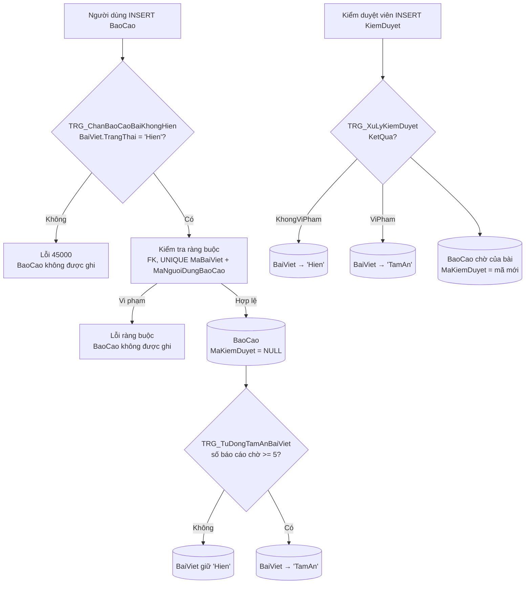
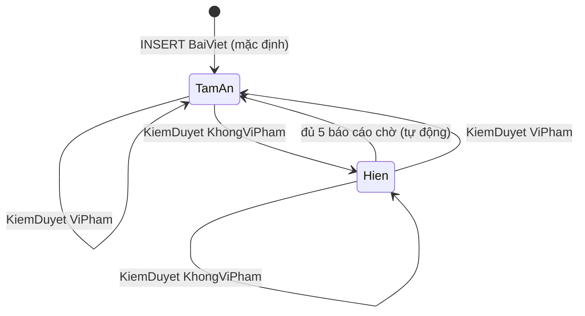

# Các trường hợp kiểm thử Trigger

Tài liệu mô tả dữ liệu đưa vào, trigger nào chạy, và dữ liệu di chuyển qua các bảng `BaoCao` → `BaiViet` → `KiemDuyet` như thế nào. Mọi mã dùng trong tài liệu khớp với [dummy.sql](dummy.sql).

## 1. Tổng quan 3 trigger

| Trigger | Thời điểm | Bảng kích hoạt | Đọc | Ghi | Việc làm |
|---|---|---|---|---|---|
| `TRG_ChanBaoCaoBaiKhongHien` | BEFORE INSERT | `BaoCao` | `BaiViet.TrangThai` | — | Bài không ở trạng thái `'Hien'` → `SIGNAL 45000`, huỷ lệnh INSERT |
| `TRG_TuDongTamAnBaiViet` | AFTER INSERT | `BaoCao` | `BaoCao` (đếm báo cáo chưa xử lý) | `BaiViet.TrangThai` | ≥ 5 báo cáo có `MaKiemDuyet IS NULL` và bài đang `'Hien'` → chuyển `'TamAn'` |
| `TRG_XuLyKiemDuyet` | AFTER INSERT | `KiemDuyet` | — | `BaiViet.TrangThai`, `BaoCao.MaKiemDuyet` | `'KhongViPham'` → bài `'Hien'`; `'ViPham'` → bài `'TamAn'`; gán `MaKiemDuyet` cho mọi báo cáo đang chờ của bài |

## 2. Luồng dữ liệu



Vòng đời trạng thái của một bài viết:



> Lưu ý: trong `dummy.sql` mọi bài được nạp thẳng với `TrangThai = 'Hien'` để có dữ liệu cho truy vấn. Như vậy là bỏ qua bước "bài mới chờ duyệt", và không trigger nào chặn việc này.

## 3. Các trường hợp có sẵn trong dummy.sql

### Case 1 — BV505: đủ 5 báo cáo, bài tự động bị ẩn

**Dữ liệu đưa vào:** BC01 → BC05 của U003, U004, U005, U006, U007 (lần lượt từng dòng trong 1 lệnh INSERT).

| Báo cáo | T1 (bài đang `Hien`?) | Số báo cáo chờ sau khi ghi | T2 | BaiViet.BV505 |
|---|---|---|---|---|
| BC01 | Có → cho qua | 1 | Không làm gì | `Hien` |
| BC02 | Có | 2 | Không làm gì | `Hien` |
| BC03 | Có | 3 | Không làm gì | `Hien` |
| BC04 | Có | 4 | Không làm gì | `Hien` |
| BC05 | Có | **5** | **UPDATE** | **`TamAn`** |

**Luồng:** `BaoCao` (5 dòng, `MaKiemDuyet = NULL`) → T2 đếm đủ 5 → `BaiViet.BV505.TrangThai = 'TamAn'`.

**Báo cáo thứ 6 bị chặn** (không có trong dummy, chạy thử bằng tay):
```sql
INSERT INTO BaoCao (MaBaoCao, MaBaiViet, MaNguoiDungBaoCao, LyDo)
VALUES ('BC99', 'BV505', 'U009', 'Spam');
-- Kỳ vọng: ERROR 1644 (45000): Chi duoc bao cao bai viet dang hien thi
```

### Case 2 — BV606: 4 báo cáo, sát ngưỡng, bài vẫn hiện

**Dữ liệu đưa vào:** BC06 → BC09 của U003, U004, U005, U006.

**Kết quả:** số báo cáo chờ = 4 < 5 → T2 không làm gì → BV606 vẫn `Hien`.

**Thêm báo cáo thứ 5 để kiểm tra ngưỡng:**
```sql
INSERT INTO BaoCao (MaBaoCao, MaBaiViet, MaNguoiDungBaoCao, LyDo)
VALUES ('BC98', 'BV606', 'U007', 'Lừa đảo');
SELECT TrangThai FROM BaiViet WHERE MaBaiViet = 'BV606';
-- Kỳ vọng: 'TamAn'
```

### Case 3 — BV402: báo cáo trước, kiểm duyệt viên kết luận vi phạm

**Dữ liệu đưa vào theo thứ tự:**
1. BC10 (U001 báo cáo BV402) → T1 cho qua, T2 đếm được 1 → bài vẫn `Hien`.
2. KD02 (U014, `KetQua = 'ViPham'`) → T3 chạy.

**Luồng của T3:**

| Bảng | Trước KD02 | Sau KD02 |
|---|---|---|
| `BaiViet.BV402.TrangThai` | `Hien` | `TamAn` |
| `BaoCao.BC10.MaKiemDuyet` | `NULL` | `KD02` |

### Case 4 — BV707: kiểm duyệt viên bác bỏ báo cáo, sau đó có báo cáo mới

**Dữ liệu đưa vào theo thứ tự:**
1. BC11 (U003) → bài `Hien`, có 1 báo cáo chờ.
2. KD01 (U013, `KetQua = 'KhongViPham'`) → T3: bài giữ `Hien`, `BC11.MaKiemDuyet = 'KD01'`.
3. BC12 (U004) → T1 cho qua vì bài vẫn `Hien`. T2 chỉ đếm báo cáo **chưa xử lý**, nên được 1 (BC11 đã có `KD01`, không tính).

| Bảng | Sau bước 1 | Sau bước 2 | Sau bước 3 |
|---|---|---|---|
| `BaiViet.BV707.TrangThai` | `Hien` | `Hien` | `Hien` |
| `BC11.MaKiemDuyet` | `NULL` | `KD01` | `KD01` |
| `BC12.MaKiemDuyet` | — | — | `NULL` |
| Số báo cáo chờ | 1 | 0 | 1 |

### Trạng thái cuối sau khi nạp dummy.sql

| Bài | TrangThai | Tổng báo cáo | Chưa xử lý | Kiểm duyệt |
|---|---|---|---|---|
| BV505 | `TamAn` | 5 | 5 | — |
| BV606 | `Hien` | 4 | 4 | — |
| BV402 | `TamAn` | 1 | 0 | KD02 (ViPham) |
| BV707 | `Hien` | 2 | 1 | KD01 (KhongViPham) |
| Các bài khác | `Hien` | 0 | 0 | — |

Câu lệnh kiểm tra:
```sql
SELECT BV.MaBaiViet, BV.TrangThai,
       COUNT(BC.MaBaoCao)          AS TongBaoCao,
       SUM(BC.MaKiemDuyet IS NULL) AS ChuaXuLy
FROM BaiViet BV
LEFT JOIN BaoCao BC ON BC.MaBaiViet = BV.MaBaiViet
GROUP BY BV.MaBaiViet, BV.TrangThai
ORDER BY BV.MaBaiViet;
```

## 4. Các trường hợp bổ sung (chạy tay sau khi nạp dummy)

### Case 5 — Bài mới chờ duyệt rồi được công khai
```sql
INSERT INTO BaiViet (MaBaiViet, MaNguoiDung, NoiDung)
VALUES ('BV900', 'U003', 'Bài mới chưa duyệt');      -- TrangThai mặc định 'TamAn'

INSERT INTO BaoCao (MaBaoCao, MaBaiViet, MaNguoiDungBaoCao, LyDo)
VALUES ('BC90', 'BV900', 'U004', 'Spam');            -- Lỗi 45000: bài chưa hiện, không báo cáo được

INSERT INTO KiemDuyet (MaKiemDuyet, MaBaiViet, MaKiemDuyetVien, KetQua)
VALUES ('KD90', 'BV900', 'U013', 'KhongViPham');     -- T3: BV900 → 'Hien'
```
**Luồng:** `BaiViet (TamAn)` → `BaoCao` bị chặn bởi T1 → `KiemDuyet` → T3 → `BaiViet (Hien)`. Không có báo cáo chờ nên T3 không cập nhật dòng `BaoCao` nào.

### Case 6 — Gỡ ẩn BV505 sau khi kiểm duyệt (bộ đếm về 0)
```sql
INSERT INTO KiemDuyet (MaKiemDuyet, MaBaiViet, MaKiemDuyetVien, KetQua, GhiChu)
VALUES ('KD91', 'BV505', 'U014', 'KhongViPham', 'Không phải quảng cáo');
```
**Kết quả:** BV505 → `Hien`; BC01–BC05 có `MaKiemDuyet = 'KD91'`; số báo cáo chờ = 0.
Muốn ẩn lại cần **5 người khác** báo cáo. U003–U007 không báo cáo lại được vì vướng `UQ_User_BaoCao_BaiViet`.

### Case 7 — Một người báo cáo trùng một bài
```sql
INSERT INTO BaoCao (MaBaoCao, MaBaiViet, MaNguoiDungBaoCao, LyDo)
VALUES ('BC92', 'BV606', 'U003', 'Báo cáo lần 2');
-- Kỳ vọng: ERROR 1062 Duplicate entry ... 'UQ_User_BaoCao_BaiViet'
```
T1 cho qua vì bài đang `Hien`, nhưng ràng buộc UNIQUE chặn, nên T2 không chạy.

### Case 8 — Báo cáo bài không tồn tại
```sql
INSERT INTO BaoCao (MaBaoCao, MaBaiViet, MaNguoiDungBaoCao, LyDo)
VALUES ('BC93', 'BV999', 'U003', 'Spam');
-- Kỳ vọng: ERROR 1452 (khoá ngoại FK_BaoCao_BaiViet), không phải lỗi 45000
```
Trong T1, `SELECT TrangThai ...` trả về `NULL` nên `NULL <> 'Hien'` không đúng, trigger cho qua. Lệnh bị chặn ở bước kiểm tra khoá ngoại.

### Case 9 — Người không phải kiểm duyệt viên ghi kết quả kiểm duyệt
```sql
INSERT INTO KiemDuyet (MaKiemDuyet, MaBaiViet, MaKiemDuyetVien, KetQua)
VALUES ('KD94', 'BV606', 'U003', 'ViPham');
-- Kỳ vọng: ERROR 1452 (FK_KiemDuyet_KDV): U003 không có trong KiemDuyetVien
```
Lệnh INSERT thất bại nên T3 không chạy. BV606 và các báo cáo giữ nguyên.

### Case 10 — Kiểm duyệt viên kết luận vi phạm với bài không có báo cáo
```sql
INSERT INTO KiemDuyet (MaKiemDuyet, MaBaiViet, MaKiemDuyetVien, KetQua)
VALUES ('KD95', 'BV301', 'U013', 'ViPham');
```
**Kết quả:** BV301 → `TamAn`. T3 không cập nhật dòng `BaoCao` nào vì bài không có báo cáo chờ.

### Case 11 — Xoá dữ liệu liên quan đến kiểm duyệt
| Thao tác | Kết quả |
|---|---|
| `DELETE FROM KiemDuyetVien WHERE MaNguoiDung = 'U013'` | KD01 giữ lại, `MaKiemDuyetVien = NULL` (ON DELETE SET NULL) |
| `DELETE FROM KiemDuyet WHERE MaKiemDuyet = 'KD01'` | Lỗi 1451: BC11 còn tham chiếu KD01 (`FK_BaoCao_KiemDuyet` không khai báo ON DELETE nên mặc định chặn xoá) |
| `DELETE FROM BaiViet WHERE MaBaiViet = 'BV707'` | Kỳ vọng xoá theo dây chuyền BC11, BC12, KD01 (ON DELETE CASCADE). **Cần chạy thử:** nếu InnoDB xoá KD01 trước BC11 thì `FK_BaoCao_KiemDuyet` có thể chặn và báo lỗi 1451 |
| `DELETE FROM NguoiDung WHERE MaNguoiDung = 'U003'` | Xoá các báo cáo U003 đã gửi (BC01, BC06, BC11). Bài BV505 **không** tự hiện lại, vì trigger chỉ chạy khi INSERT |

> Các case 5–11 làm thay đổi dữ liệu. Chạy lại `create.sql` rồi `dummy.sql` để về trạng thái ban đầu trước khi chụp kết quả cho 8 truy vấn.
