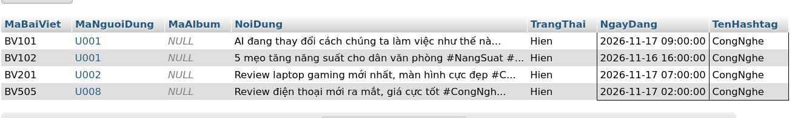
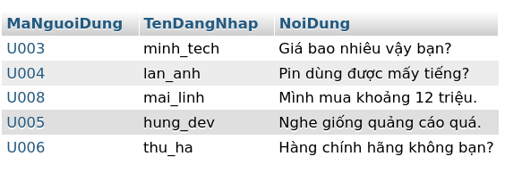
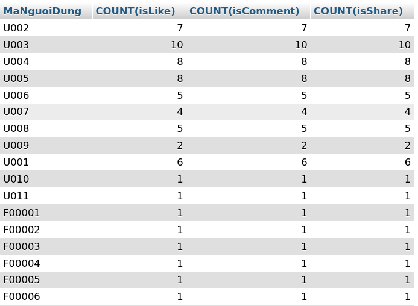
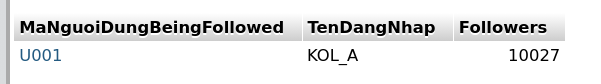
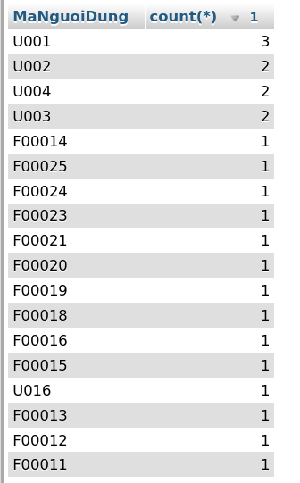
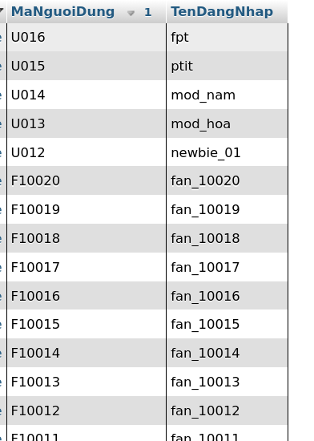
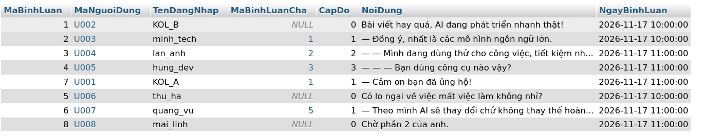
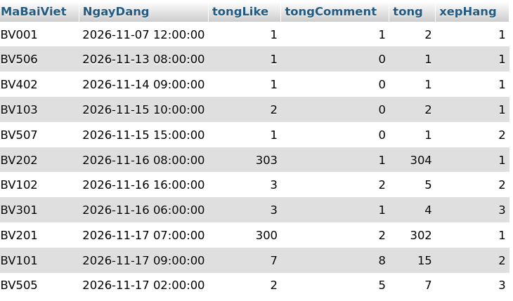

# Truy vấn

## 1. Cơ bản: Danh sách bài viết được đăng trong 24 giờ qua có chứa Hashtag #CongNghe.
```sql
SELECT BV.MaBaiViet, BV.MaNguoiDung, BV.MaAlbum, BV.NoiDung, BV.TrangThai, BV.NgayDang, H.TenHashtag
FROM BaiViet BV
JOIN BaiViet_Hashtag BVH ON BV.MaBaiViet = BVH.MaBaiViet
JOIN Hashtag H ON H.MaHashtag = BVH.MaHashtag
WHERE H.TenHashtag = 'CongNghe'
  AND BV.NgayDang >= DATE_SUB(CURRENT_TIMESTAMP(), INTERVAL 24 HOUR);
```


## 2. Inner Join: Hiển thị danh sách những người dùng đã bình luận vào bài viết BV505 kèm nội dung bình luận.
```sql
SELECT ND.MaNguoiDung, ND.TenDangNhap, BL.NoiDung
FROM NguoiDung ND
JOIN BinhLuan BL ON BL.MaNguoiDung = ND.MaNguoiDung
WHERE BL.MaBaiViet = 'BV505';
```


## 3. Group By: Thống kê tổng số lượt tương tác (Like + Comment + Share) của từng người dùng trong tuần.
```sql
SELECT ND.MaNguoiDung,
       SUM(isLike)    AS SoLike,
       SUM(isComment) AS SoComment,
       SUM(isShare)   AS SoShare,
       SUM(isLike) + SUM(isComment) + SUM(isShare) AS TongTuongTac
FROM NguoiDung ND
JOIN (
    SELECT MaNguoiDung, 1 AS isLike, 0 AS isComment, 0 AS isShare
    FROM TuongTac
    WHERE NgayTuongTac >= DATE_SUB(CURRENT_DATE(), INTERVAL 7 DAY)

    UNION ALL

    SELECT MaNguoiDung, 0, 1, 0
    FROM BinhLuan
    WHERE NgayBinhLuan >= DATE_SUB(CURRENT_DATE(), INTERVAL 7 DAY)

    UNION ALL

    SELECT MaNguoiDung, 0, 0, 1
    FROM ChiaSe
    WHERE NgayChiaSe >= DATE_SUB(CURRENT_DATE(), INTERVAL 7 DAY)
) tmp ON tmp.MaNguoiDung = ND.MaNguoiDung
GROUP BY ND.MaNguoiDung;
```


## 4. Having: Tìm những người dùng có số lượng follower > 10.000 nhưng có tỷ lệ tương tác trung bình trên mỗi bài viết < 0.5%.
```sql
WITH
tmp1 AS (
    SELECT TuongTac.MaBaiViet AS MBV, COUNT(*) AS LikePerPost
    FROM TuongTac
    GROUP BY TuongTac.MaBaiViet
),
tmp2 AS (
    SELECT ND.MaNguoiDung AS MND, AVG(LikePerPost) AS AVGLikePerPost
    FROM tmp1
    JOIN BaiViet BV ON tmp1.MBV = BV.MaBaiViet
    JOIN NguoiDung ND ON ND.MaNguoiDung = BV.MaNguoiDung
    GROUP BY ND.MaNguoiDung
)
SELECT TheoDoi.MaNguoiDungBeingFollowed, ND.TenDangNhap,
       COUNT(*) AS Followers, tmp2.AVGLikePerPost
FROM TheoDoi
JOIN NguoiDung ND ON ND.MaNguoiDung = TheoDoi.MaNguoiDungBeingFollowed
JOIN tmp2 ON TheoDoi.MaNguoiDungBeingFollowed = tmp2.MND
GROUP BY TheoDoi.MaNguoiDungBeingFollowed, ND.TenDangNhap, tmp2.AVGLikePerPost
HAVING Followers > 10000
   AND tmp2.AVGLikePerPost < 0.5 / 100 * Followers;
```


## 5. Outer Join: Liệt kê tất cả người dùng và số bài viết họ đã đăng (bao gồm cả người dùng chưa từng đăng bài).
```sql
SELECT ND.MaNguoiDung, COUNT(BV.MaBaiViet) AS SoBaiViet
FROM NguoiDung ND
LEFT JOIN BaiViet BV ON BV.MaNguoiDung = ND.MaNguoiDung
GROUP BY ND.MaNguoiDung;
```


## 6. Subquery với NOT EXISTS: Tìm những người dùng chưa từng tương tác (Like/Comment) với bất kỳ bài viết nào của người dùng "KOL_A".
```sql
SELECT ND.MaNguoiDung, ND.TenDangNhap
FROM NguoiDung ND
WHERE NOT EXISTS (
    SELECT 1
    FROM TuongTac TT
    JOIN BaiViet BV ON BV.MaBaiViet = TT.MaBaiViet
    JOIN NguoiDung tacGia ON tacGia.MaNguoiDung = BV.MaNguoiDung
    WHERE TT.MaNguoiDung = ND.MaNguoiDung
      AND tacGia.TenDangNhap = 'KOL_A'
)
AND NOT EXISTS (
    SELECT 1
    FROM BinhLuan BL
    JOIN BaiViet BV ON BV.MaBaiViet = BL.MaBaiViet
    JOIN NguoiDung tacGia ON tacGia.MaNguoiDung = BV.MaNguoiDung
    WHERE BL.MaNguoiDung = ND.MaNguoiDung
      AND tacGia.TenDangNhap = 'KOL_A'
);
```


## 7. Recursive CTE: Truy vấn toàn bộ luồng bình luận (Comment tree - bao gồm các reply cấp 1, cấp 2, cấp 3) của bài viết BV101.
```sql
WITH RECURSIVE TREE AS (
    SELECT BL.MaBaiViet, BL.MaNguoiDung, BL.MaBinhLuan, BL.MaBinhLuanCha,
           BL.NoiDung, BL.NgayBinhLuan,
           0 AS CapDo,
           CAST(BL.MaBinhLuan AS CHAR(200)) AS DuongDan
    FROM BinhLuan BL
    WHERE BL.MaBaiViet = 'BV101'
      AND BL.MaBinhLuanCha IS NULL

    UNION ALL

    SELECT BL.MaBaiViet, BL.MaNguoiDung, BL.MaBinhLuan, BL.MaBinhLuanCha,
           BL.NoiDung, BL.NgayBinhLuan,
           TREE.CapDo + 1,
           CONCAT(TREE.DuongDan, '/', BL.MaBinhLuan)
    FROM BinhLuan BL
    JOIN TREE ON BL.MaBinhLuanCha = TREE.MaBinhLuan
)
SELECT TREE.MaBinhLuan, TREE.MaNguoiDung, ND.TenDangNhap, TREE.MaBinhLuanCha, TREE.CapDo,
       CONCAT(REPEAT('— ', TREE.CapDo), TREE.NoiDung) AS NoiDung,
       TREE.NgayBinhLuan
FROM TREE
JOIN NguoiDung ND ON ND.MaNguoiDung = TREE.MaNguoiDung
ORDER BY TREE.DuongDan;
```


## 8. Window Functions: Xếp hạng top 3 bài viết có lượng tương tác cao nhất mỗi ngày bằng ROW_NUMBER() OVER(PARTITION BY NgayDang ORDER BY TongTuongTac DESC).
```sql
WITH ThongKeBaiViet AS (
    SELECT bv.MaBaiViet,
           bv.NgayDang,
           SUM(tmp.isLike)    AS tongLike,
           SUM(tmp.isComment) AS tongComment,
           SUM(tmp.isLike) + SUM(tmp.isComment) AS tong,
           ROW_NUMBER() OVER (
               PARTITION BY DATE(bv.NgayDang)
               ORDER BY SUM(tmp.isLike) + SUM(tmp.isComment) DESC
           ) AS xepHang
    FROM BaiViet bv
    JOIN (
        SELECT tt.MaBaiViet, 1 AS isLike, 0 AS isComment FROM TuongTac tt
        UNION ALL
        SELECT bl.MaBaiViet, 0 AS isLike, 1 AS isComment FROM BinhLuan bl
    ) tmp ON bv.MaBaiViet = tmp.MaBaiViet
    GROUP BY bv.MaBaiViet, bv.NgayDang
)
SELECT MaBaiViet, NgayDang, tongLike, tongComment, tong, xepHang
FROM ThongKeBaiViet
WHERE xepHang <= 3;
```

